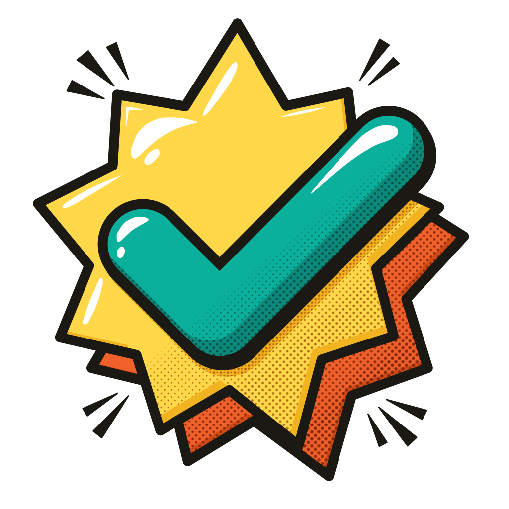
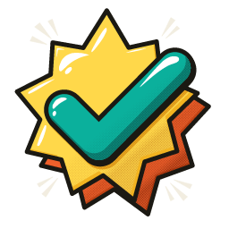
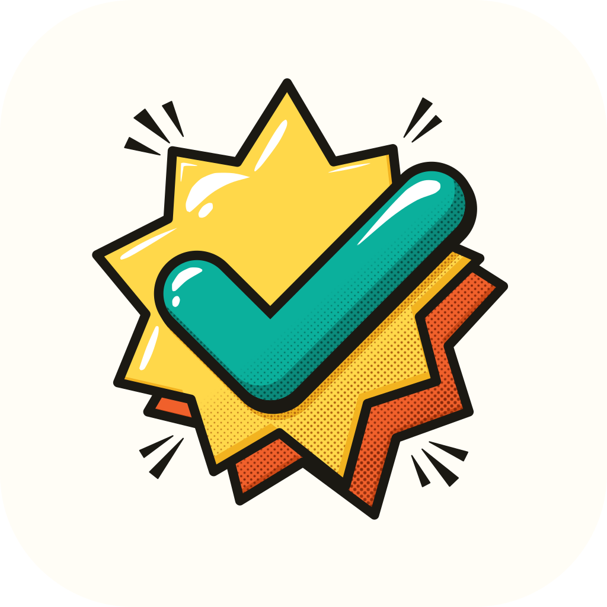
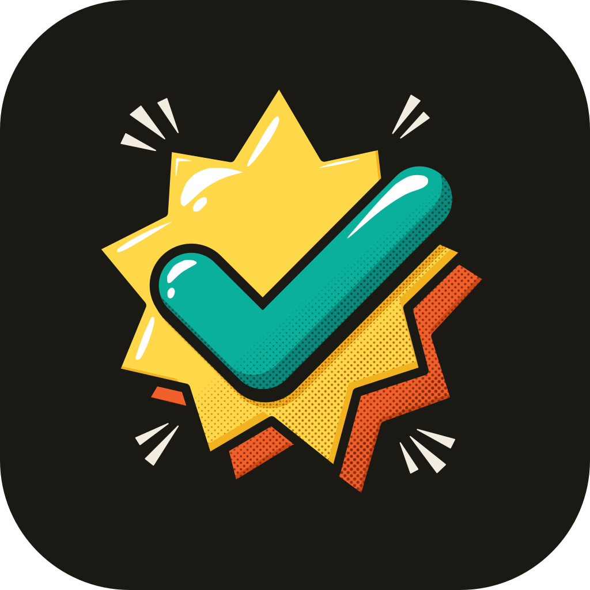
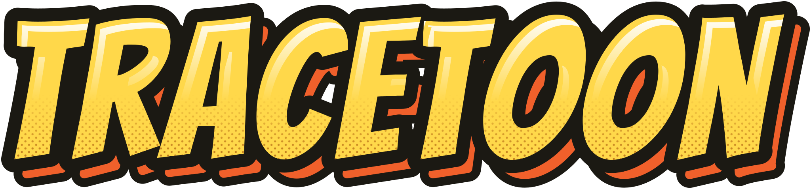
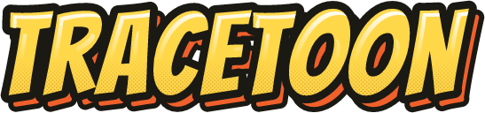
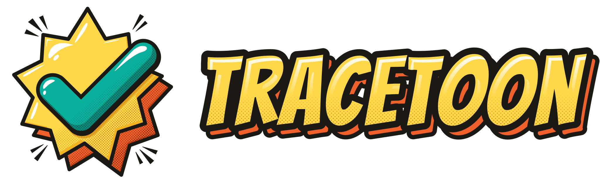
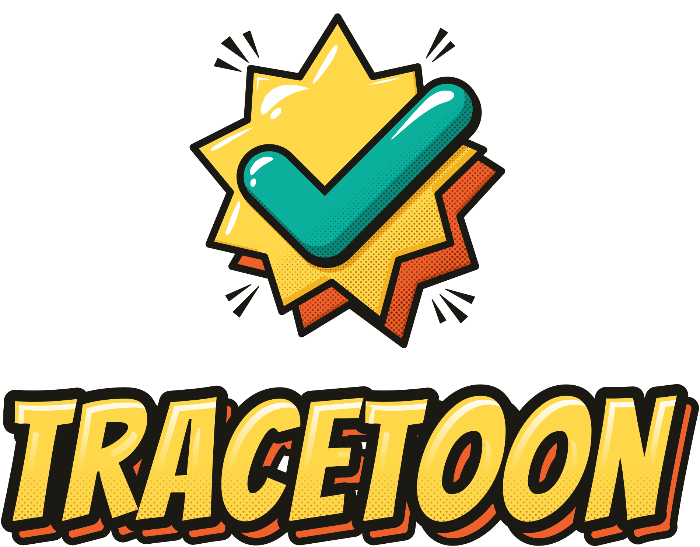
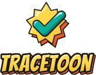

# Tracetoon logo kit

The Tracetoon icon, wordmark and lockups, for light and dark backgrounds, as
SVG and PNG. Use these files whenever you refer to Tracetoon: in a blog post, a
talk, a list of tools, or your own README ("PRs made with Tracetoon").

**Download everything:** `tracetoon-brand-kit.zip` is attached to every
[release](https://github.com/Tracetoon/tracetoon/releases/latest). It holds
every file below plus larger PNGs (1024 px icons, 512 px tall wordmarks).

## The marks

| | On light | On dark | Files |
| --- | --- | --- | --- |
| **Icon** |  |  | [SVG](tracetoon-icon.svg), [dark SVG](tracetoon-icon-dark.svg); PNG [64](png/tracetoon-icon-64.png) · [128](png/tracetoon-icon-128.png) · [256](png/tracetoon-icon-256.png) · [512](png/tracetoon-icon-512.png), dark [64](png/tracetoon-icon-dark-64.png) · [128](png/tracetoon-icon-dark-128.png) · [256](png/tracetoon-icon-dark-256.png) · [512](png/tracetoon-icon-dark-512.png) |
| **App tile** |  |  | [light SVG](tracetoon-icon-tile-light.svg), [dark SVG](tracetoon-icon-tile-dark.svg); PNG light [256](png/tracetoon-icon-tile-light-256.png) · [512](png/tracetoon-icon-tile-light-512.png), dark [256](png/tracetoon-icon-tile-dark-256.png) · [512](png/tracetoon-icon-tile-dark-512.png) |
| **Wordmark** |  |  | [SVG](tracetoon-wordmark.svg) (one version for both); PNG [128 tall](png/tracetoon-wordmark-128h.png) · [256 tall](png/tracetoon-wordmark-256h.png) |
| **Lockup** |  |  | [SVG](tracetoon-lockup.svg), [dark SVG](tracetoon-lockup-dark.svg); PNG [128](png/tracetoon-lockup-128h.png) · [256](png/tracetoon-lockup-256h.png) tall, dark [128](png/tracetoon-lockup-dark-128h.png) · [256](png/tracetoon-lockup-dark-256h.png) |
| **Stacked lockup** |  |  | [SVG](tracetoon-lockup-stacked.svg), [dark SVG](tracetoon-lockup-stacked-dark.svg); PNG [128](png/tracetoon-lockup-stacked-128h.png) · [256](png/tracetoon-lockup-stacked-256h.png) tall, dark [128](png/tracetoon-lockup-stacked-dark-128h.png) · [256](png/tracetoon-lockup-stacked-dark-256h.png) |

The dark versions differ only in the icon's impact lines, which turn cream so
they show on a dark background. The wordmark is the same on both.

In a GitHub README, this picks the right lockup for the reader's theme:

```html
<picture>
  <source media="(prefers-color-scheme: dark)" srcset="https://raw.githubusercontent.com/Tracetoon/tracetoon/main/docs/brand/tracetoon-lockup-dark.svg">
  
</picture>
```

## Web icons and social card

- [`favicon/`](favicon/): `favicon.svg` (adapts to dark mode), `favicon.ico`
  (16, 32 and 48 px), PNG favicons, `apple-touch-icon.png`, `icon-192.png`,
  `icon-512.png`, `icon-maskable-512.png` and `site.webmanifest`.
- [`tracetoon-social.png`](tracetoon-social.png): 1280×640 card for link
  previews (GitHub social preview, `og:image`).

## Colours

| Name | Hex | Used for |
| --- | --- | --- |
| Pow yellow | `#ffd84a` | Burst, letters |
| Pow orange | `#f0602b` | Offset burst, letter shadow |
| Check teal | `#0bb09c` (shadow `#0b8a7b`) | Checkmark |
| Ink | `#1b1913` | Outlines; dark tile |
| Paper | `#fffdf6` | Light background; light tile |
| Night | `#14130f` | Dark background |
| Cream ink | `#f2ede0` | Impact lines on dark |

## Using the marks

- **Do** use the files as they are, at any size from 16 px (icon) or 24 px
  tall (wordmark) up.
- **Do** leave clear space around the mark of at least the checkmark's width.
- **Do** use the `-dark` files on dark backgrounds and the tiles where a
  square app icon is expected.
- **Don't** recolour, stretch, rotate, outline, add effects or retype the
  lettering, and don't put the marks on busy photos.
- **Don't** use them in a way that suggests Tracetoon endorses your product.

## Licence

The logo files are part of the Tracetoon repository and covered by its
[Apache-2.0 licence](../../LICENSE); use them to refer to Tracetoon. The
lettering is set in [Bangers](https://github.com/googlefonts/bangers)
(© The Bangers Project Authors), under the SIL Open Font License 1.1
([`src/OFL-Bangers.txt`](src/OFL-Bangers.txt)), and converted to outlines.

## For maintainers

`src/icon.svg` and `src/wordmark.svg` are the sources. Everything else here is
generated by `bun scripts/brand.ts`; `bun scripts/brand.ts --check` (also run
by the tests) fails when a generated file is out of date. The release workflow
attaches the zip (`bun scripts/brand.ts --zip tracetoon-brand-kit.zip`).
